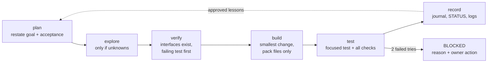
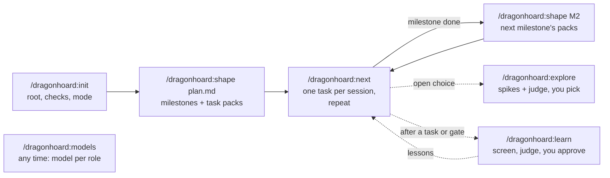

# dragonhoard

<p align="center">
  
</p>

<p align="center">
  <b>plan · explore · verify · build · test · record</b><br>
  one task at a time, learning as it goes
</p>

**A coding agent that gets better at your project with every task, and never changes how it
works without your sign-off.**

Self-improving agents are everywhere; most let the model rewrite its own rules. dragonhoard
learns too, but every lesson passes a deterministic screen, a frontier-model judge and **your
approval** before any later task uses it.

- **Learns, gated.** Failures and fixes become lessons; nothing is approved automatically.
- **One task, small context.** Your plan becomes milestones and self-contained task packs; the
  agent loads one pack, not the whole repo.
- **Evidence, not claims.** Failing test first, real command output in the journal, and `check`
  must PASS before a task counts as done.
- **Memory across sessions.** Append-only logs and a generated digest let a fresh session pick
  up where the last one stopped.
- **Frontier judge, cheap builder (optional).** Hybrid mode lets a free OpenCode model build
  while Claude Code judges and re-verifies every result.

**Proven on a real build.** In an open reliability trial, dragonhoard took a one-page plan to a
playable 3D kart racer in 95 tasks with zero false "done"s. A headless OpenCode builder did most of
the work for $4.60 of paid tokens while Claude Code judged.
[Results, evidence and what failed](evals/kart-racer/README.md).

Runs as a Claude Code plugin, and in OpenCode, Codex CLI, Cline or any agent that reads
`AGENTS.md`.

## How one task runs

Each session works exactly one task through **plan → explore → verify → build → test → record**,
then stops.



| Step | What you get |
|---|---|
| plan | A wrong or stale pack stops the task instead of being quietly rewritten, so scope never drifts. |
| explore | Cheap parallel scouts for facts, spikes in isolated worktrees for open choices. Each choice is logged once and not argued again. |
| verify | No building on interfaces that don't exist or on a build that is already red. The test fails first, for the expected reason. |
| build | The diff stays inside the pack's file list: small, reviewable changes. |
| test | Two failed attempts at the same issue mean BLOCKED: no endless retry loop, no fake DONE. |
| record | Journal, `events.jsonl` and `DIGEST.md` let the next session start cold with full memory, and let you audit every claim. |

## Modes

`/dragonhoard:init` asks which of two delivery modes to use:
- **Full Claude Code** (`solo`): this session builds; scout, spiker and judge are Claude subagents.
- **Claude Code + OpenCode** (`hybrid`): Claude Code orchestrates, judges and verifies with
  `/dragonhoard:conduct`; a headless OpenCode session builds each task on a cheaper or free model.

Trade-offs, setup and measured costs: [docs/modes.md](docs/modes.md).

## Install

Requires `python3` (stdlib only).

**Claude Code** (plugin):

```bash
claude --plugin-dir /path/to/dragonhoard     # try it for one session
# or, permanently:
/plugin marketplace add /path/to/dragonhoard
/plugin install dragonhoard@dragonhoard
```

**OpenCode, Codex CLI, Cline, or any agent that reads `AGENTS.md`** (copied into your project):

```bash
git clone https://github.com/edwinidrus/dragonhoard.git ~/dragonhoard
cd your-project
python3 ~/dragonhoard/scripts/dragonhoard.py install --host opencode   # or codex | cline | generic
```

`install` copies the CLI and templates to `.dragonhoard/`, puts the skills where the host looks
for them (as `dragonhoard-init`, `dragonhoard-next`, …), and writes role agents where the host
supports them. It also adds a marked block to `AGENTS.md` (Cline: `.clinerules/dragonhoard.md`)
that tells the agent to read the digest at session start. Re-run it to upgrade. Text outside the
markers is never touched.

| Host | Skills | Roles on their own model | Tier |
|---|---|---|---|
| Claude Code | plugin | yes (subagents) | full |
| OpenCode | `.opencode/skills/` | yes (`.opencode/agents/`) | full |
| Codex CLI | `.agents/skills/` | yes (`.codex/agents/*.toml`) | full |
| Cline | `.cline/skills/` (enable Skills in settings) | no: inline, judge pauses | inline |
| Generic (Cursor, Gemini CLI, Copilot, …) | `.agents/skills/` | no: inline, judge pauses | inline |

Details and sources: [docs/hosts.md](docs/hosts.md).

## Use



In hybrid mode, `/dragonhoard:conduct` runs the same loop and a headless OpenCode session builds.

| Command | What it does |
|---|---|
| `/dragonhoard:init` | Asks where the workspace lives (`implementation/`, `improvement/`, or your choice), confirms your check commands, then scaffolds the root files. |
| `/dragonhoard:shape <plan.md>` | Proposes a milestone cut and waits for your OK. Then writes the milestone folders, `STATUS.md` and task packs for the first milestone. `/dragonhoard:shape M2` writes the next milestone's packs when it comes up. |
| `/dragonhoard:next` | Works exactly one task through the loop, records real evidence, and stops. |
| `/dragonhoard:explore` | For an open choice: cheap parallel retrieval, up to 3 parallel spikes in isolated worktrees, a comparison by a frontier model. You pick; the decision is logged. |
| `/dragonhoard:learn` | Drafts lessons from journals, screens them deterministically, has the judge review them, then asks you to approve each. `revoke L<nn>` removes one. |
| `/dragonhoard:models` | The current model suggests which model fits each role, using the host's model list and the journey's evidence; you confirm. |
| `/dragonhoard:conduct` | Hybrid mode only. Delegates each task to the OpenCode builder, judges its requests, verifies every result (`dragonhoard.py verify`), escalates repeated failures, and runs gates. |

On other hosts the commands are the skills `dragonhoard-init`, `dragonhoard-next`, and so on.

At session start, the digest is printed: by a hook in Claude Code, and through the `AGENTS.md`
instruction elsewhere. Nothing is printed in projects without `dragonhoard.json`.

## What it creates in your project

```text
dragonhoard.json              # {"root": "...", "checks": [...]}
<root>/
├── README.md CONSTITUTION.md STATUS.md
├── DIGEST.md LESSONS.md      # generated from the logs
├── logs/events.jsonl         # what happened, across the journey
├── logs/lessons.jsonl        # lesson ledger: approved, rejected, revoked
├── templates/                # TASK.md + phase skeletons
└── M<n>-<name>/{CONSTITUTION,PLAN,PROGRESS,GATE}.md, tasks/<pack>.md, tasks/<pack>.journal.md
```

## Models

Models are configured per role in `dragonhoard.json`. No model names are hardcoded: the current
model suggests a mapping with `/dragonhoard:models` and you confirm it.

| Role | Needs | Claude Code default | Job |
|---|---|---|---|
| `scout` | fast, cheap, reliable tool use | haiku | Read-only fact retrieval with sources. Run in parallel. |
| `spiker` | solid coding at mid cost | sonnet | One throwaway prototype per option, each in its own git worktree. |
| `judge` | strongest available reasoning | opus | Compares spike evidence and reviews lessons. Advises only: it can add warnings, never approve. |

Other hosts start with no models set. On hosts that can't run a subagent on its own model, the
judge step pauses and asks you to switch the session to the judge model.

Every lesson passes four gates: deterministic screen → judge → **your approval** → used from
the next task on. Nothing is approved automatically.
