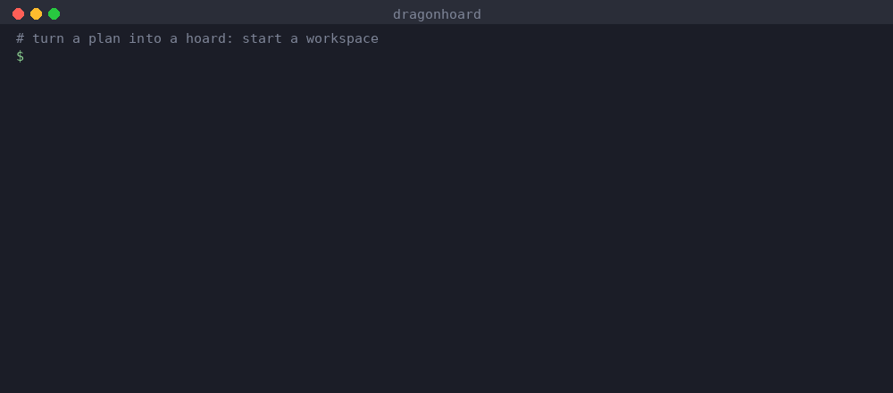
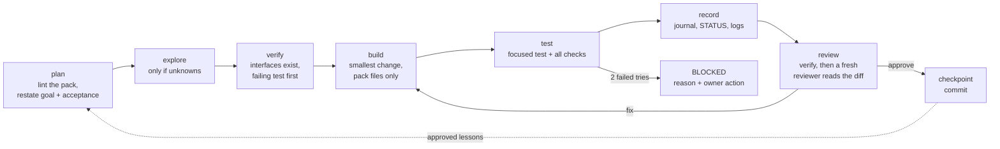
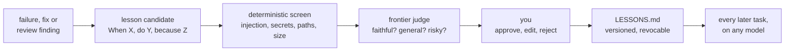
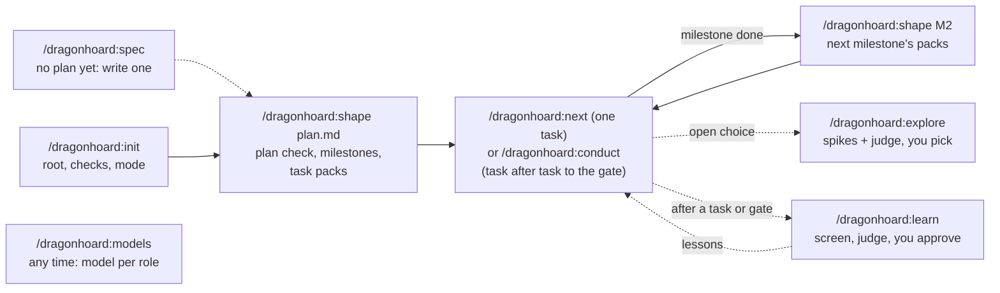

# dragonhoard

<p align="center">
  
</p>

<p align="center">
  <b>plan · explore · verify · build · test · record · review</b><br>
  one task at a time, learning as it goes
</p>

<p align="center">
  <a href="https://github.com/edwinidrus/dragonhoard/actions/workflows/test.yml"></a>
  <a href="LICENSE"></a>
  
  
  
</p>

**A self-improving harness for coding agents: it gets better at your project with every task,
without fine-tuning, and without letting the model rewrite its own rules.**

The weights never change. What improves is the context: failures and fixes become lesson
candidates, and each candidate passes a deterministic screen, a frontier-model judge and **your
approval**. From the next task on, every model you use works with it, including a free one.

<p align="center">
  
</p>

- **Learns, gated.** Failures, fixes and review findings become lessons, each with provenance
  and a revoke. Nothing is approved automatically.
- **One task, small context.** Your plan becomes milestones and self-contained task packs. Each
  task is built in its own context, from one pack, not the whole repo.
- **Evidence, not claims.** Failing test first, real command output in the journal, and the
  checks re-run independently before a task counts as done.
- **Reviewed before it is committed.** A reviewer that did not build the task reads its diff
  against the pack. Nothing is committed until verify and review have passed on the same code.
- **Runs to the gate on its own.** `/dragonhoard:conduct` takes task after task and stops only at
  a milestone gate or for a decision that is yours.
- **Memory across sessions.** Append-only logs and a generated digest let a fresh session pick
  up where the last one stopped.
- **Frontier judge, cheap builder (optional).** Hybrid mode lets a free OpenCode model build
  while Claude Code judges, verifies and reviews every result.

**Proven on a real build.** In an open reliability trial, dragonhoard took a one-page plan to a
playable 3D kart racer in 96 tasks with zero false "done"s. A headless OpenCode builder did most of
the work for $4.60 of paid tokens while Claude Code judged.
[Results, evidence and what failed](evals/kart-racer/README.md).

**v0.4 closes the gaps that trial exposed:** a spec step before planning, a review of every task,
stale packs caught before a session is spent, gated commits, and a run mode for both modes. Each
new part has been exercised on small projects, not yet trialled at that scale.
[What v0.4 changed, and what is still open](docs/v0.4-gaps.md).

Runs as a Claude Code plugin, and in OpenCode, Codex CLI, Cline or any agent that reads
`AGENTS.md`. How it compares with Superpowers, Spec Kit, BMAD and others:
[docs/compare.md](docs/compare.md).

## Quick start

```text
/dragonhoard:init                 # delivery mode, workspace folder, check commands
/dragonhoard:spec                 # no written plan yet? it asks, then writes one with you
/dragonhoard:shape docs/plan.md   # plan check, milestone cut (you approve), task packs
/dragonhoard:conduct              # task after task, verified, reviewed and committed, to the gate
```

Prefer to watch each step? Use `/dragonhoard:next` for one task at a time. For a small fix
outside the plan, use `/dragonhoard:quick "<what>"`.

## How one task runs

Each task is worked alone, in its own context, through
**plan → explore → verify → build → test → record → review**.



| Step | What you get |
|---|---|
| plan | `lint` refuses a stale pack before any work starts. A wrong pack stops the task instead of being quietly rewritten, and an approved amendment is logged, so scope never drifts. |
| explore | Cheap parallel scouts for facts, spikes in isolated worktrees for open choices. Each choice is logged once and not argued again. |
| verify | No building on interfaces that don't exist or on a build that is already red. The test fails first, for the expected reason. |
| build | The diff stays inside the pack's file list: small, reviewable changes. |
| test | A second attempt needs a root cause first. Two failed attempts at the same issue mean BLOCKED: no endless retry loop, no fake DONE. |
| record | Journal, `events.jsonl` and `DIGEST.md` let the next session start cold with full memory, and let you audit every claim. |
| review | `verify` re-runs the checks and compares the diff with the pack. Then a reviewer that did not build the task reads the diff against the pack. `checkpoint` commits only after both passed. |

## Quality gates

Each gate is either code in the CLI, which costs no tokens and cannot drift, or a model with a
fresh context that did not do the work.

| Gate | What it stops | Enforced by |
|---|---|---|
| `lint` | A pack that consumes a missing file, a line past the end of a file, or a task that comes later; more than 3 implementation files | CLI, before the task starts |
| Failing test first | A test that would pass without the change | the skill; the failing run is recorded in the journal |
| Root cause | A retry with no idea why the first attempt failed | CLI: `verify` fails a FAIL attempt with no root cause |
| `verify` | Red checks, files changed outside the pack, deleted assertions or new skip marks, a missing journal | CLI, run by the orchestrator, never trusted from the builder |
| Review | Code that passes the tests but not the pack: a forbidden type, out-of-scope work, a test that proves nothing, an unrecorded pack change | a reviewer subagent that did not build the task |
| `checkpoint` | A commit before verify and review passed, or of code edited since; files that look like secrets | CLI, the only code that commits; it never pushes |
| Gate | A milestone that does not work end to end | the gate commands, a review of the whole milestone, and your hands-on check |
| Owner override | An instruction that breaks the constitution or the plan, even yours | constitution article 18: it becomes a question, and a confirmed exception is logged |

In the v0.4 exercises, review caught a planted defect that every test and `verify` accepted, and
`checkpoint` refused a hand-logged approval because the code had changed since it was verified.

## How it learns



This is self-improvement through context rather than weights: the approach of *Agentic Context
Engineering* ([ACE, ICLR 2026](https://arxiv.org/abs/2510.04618)). ACE improves agents by growing
an itemized playbook, and it warns that letting the model rewrite its whole context causes
"context collapse". dragonhoard's lessons are itemized, append-only and gated, so a bad lesson
can't quietly overwrite a good one, and every lesson has an owner.

What the trial showed:
- 7 candidates: 6 approved, 1 rejected. The rejected one was an injected "ignore previous
  instructions" lesson, stopped by the screen.
- Lessons carry across models. Most were approved while Claude built (M0–M3); in the hybrid
  phase (M4–M10), the cheaper OpenCode builder cited a lesson in 40 of its 82 journals.
- Not measured yet: how much the lessons raise the first-pass rate. That needs a lessons-on vs
  lessons-off run, which is designed in [evals/lessons-ab](evals/lessons-ab/scorecard.md).

See it for your own project with `dragonhoard.py stats`. Per milestone it prints the first-pass
rate, the lessons in force, the journals that cite one, and how many tasks review sent back. A
task sent back by review does not count as first pass.

## Modes

`/dragonhoard:init` asks which of two delivery modes to use:
- **Full Claude Code** (`solo`): this session builds with `/dragonhoard:next`, or
  `/dragonhoard:conduct` gives each task to a fresh builder subagent. Scout, spiker, judge and
  reviewer are Claude subagents.
- **Claude Code + OpenCode** (`hybrid`): Claude Code orchestrates, judges, verifies and reviews
  with `/dragonhoard:conduct`; a headless OpenCode session builds each task on a cheaper or free
  model. A rate limit is waited out; a spending cap stops the run at once and tells you.

Trade-offs, setup and measured costs: [docs/modes.md](docs/modes.md).

## Install

Requires `python3` (stdlib only).

**Claude Code** (plugin):

```bash
/plugin marketplace add edwinidrus/dragonhoard
/plugin install dragonhoard@dragonhoard
# or try a local clone for one session:
claude --plugin-dir /path/to/dragonhoard
```

**OpenCode, Codex CLI, Cline, or any agent that reads `AGENTS.md`** (copied into your project):

```bash
git clone https://github.com/edwinidrus/dragonhoard.git ~/dragonhoard
cd your-project
python3 ~/dragonhoard/scripts/dragonhoard.py install --host opencode   # or codex | cline | generic
```

`install` copies the CLI and templates to `.dragonhoard/`, puts the skills where the host looks
for them (as `dragonhoard-init`, `dragonhoard-next`, …), and writes role agents where the host
supports them. It also adds a marked block to `AGENTS.md` (Cline: `.clinerules/dragonhoard.md`)
that tells the agent to read the digest at session start. Text outside the markers is never
touched.

| Host | Skills | Roles on their own model | Tier |
|---|---|---|---|
| Claude Code | plugin | yes (subagents) | full |
| OpenCode | `.opencode/skills/` | yes (`.opencode/agents/`) | full |
| Codex CLI | `.agents/skills/` | yes (`.codex/agents/*.toml`) | full |
| Cline | `.cline/skills/` (enable Skills in settings) | no: inline, judge pauses | inline |
| Generic (Cursor, Gemini CLI, Copilot, …) | `.agents/skills/` | no: inline, judge pauses | inline |

A review needs a context that did not build the task. On inline hosts the per-task review is
skipped and the gate review covers it. `/dragonhoard:conduct` runs from Claude Code. Details and
sources: [docs/hosts.md](docs/hosts.md).

### Upgrade

```bash
claude plugin marketplace update dragonhoard && claude plugin update dragonhoard@dragonhoard   # Claude Code
python3 ~/dragonhoard/scripts/dragonhoard.py install --host <host>                         # other hosts, after git pull
```

Existing workspaces keep their own `CONSTITUTION.md` and `README.md`. New rules reach them
through the skills; copy a new constitution article in by hand if you want it written down.

## Use



| Command | What it does |
|---|---|
| `/dragonhoard:init` | Asks the delivery mode and where the workspace lives (`implementation/`, `improvement/`, or your choice), confirms your check commands, then scaffolds the root files. |
| `/dragonhoard:spec` | No written plan yet: asks what you want, one question at a time, plays it back, and writes the plan file. |
| `/dragonhoard:shape <plan.md>` | Has the judge read the plan as its builder would and asks you what is missing. Proposes a milestone cut and waits for your OK. Then writes the milestone folders, `STATUS.md` and task packs for the first milestone, and lints them. `/dragonhoard:shape M2` writes the next milestone's packs when it comes up. |
| `/dragonhoard:next` | Works exactly one task through the loop, records real evidence, has it reviewed, and stops. |
| `/dragonhoard:conduct` | Claude Code. Runs task after task to the gate: gives each one to a fresh builder (a subagent in solo, OpenCode in hybrid), answers its judge requests, then verifies, reviews and checkpoints the result. Escalates repeated failures, reviews the whole milestone and runs the gate. |
| `/dragonhoard:quick "<fix>"` | A small fix with no milestones: the same loop (lessons, failing test first, checks, journal) as one quick task `Q<nn>`. Hands off to `shape` if it grows. |
| `/dragonhoard:explore` | For an open choice: cheap parallel retrieval, up to 3 parallel spikes in isolated worktrees, a comparison by a frontier model. You pick; the decision is logged. |
| `/dragonhoard:learn` | Drafts lessons from journals, failed verifies and review findings, screens them deterministically, has the judge review them, then asks you to approve each. `revoke L<nn>` removes one. |
| `/dragonhoard:models` | The current model suggests which model fits each role, using the host's model list and the journey's evidence; you confirm. |

On other hosts the commands are the skills `dragonhoard-init`, `dragonhoard-next`, and so on.

The skills call the CLI for everything that must not drift. You can run it yourself too:

| `python3 scripts/dragonhoard.py …` | What it does |
|---|---|
| `next` | The task in progress, or the first one whose dependencies are done. |
| `check` · `lint [task]` | STATUS and PROGRESS agree and named files exist · no pack is stale. |
| `verify <task>` | Re-runs the checks; scope, weakened tests and journal. |
| `checkpoint <task>` · `checkpoint G<n>` | Commits a task after verify and review passed · commits a gate's record. |
| `stats` · `digest` | The learning scorecard · rebuilds `DIGEST.md`. |

At session start, the digest is printed: by a hook in Claude Code, and through the `AGENTS.md`
instruction elsewhere. Nothing is printed in projects without `dragonhoard.json`.

## What it creates in your project

```text
dragonhoard.json              # {"root": "...", "checks": [...], "mode": "...", "models": {...}}
<root>/
├── README.md CONSTITUTION.md STATUS.md
├── DIGEST.md LESSONS.md      # generated from the logs
├── logs/events.jsonl         # what happened, across the journey
├── logs/lessons.jsonl        # lesson ledger: approved, rejected, revoked
├── logs/sessions/            # hybrid: builder transcripts, git-ignored
├── templates/                # TASK.md + phase skeletons
├── quick/Q<nn>-<slug>.journal.md   # quick tasks, outside the milestones
└── M<n>-<name>/{CONSTITUTION,PLAN,PROGRESS,GATE}.md, tasks/<pack>.md, tasks/<pack>.journal.md
```

## Models

Models are configured per role in `dragonhoard.json`. No model names are hardcoded: the current
model suggests a mapping with `/dragonhoard:models` and you confirm it.

| Role | Needs | Claude Code default | Job |
|---|---|---|---|
| `scout` | fast, cheap, reliable tool use | haiku | Read-only fact retrieval with sources. Run in parallel. |
| `spiker` | solid coding at mid cost | sonnet | One throwaway prototype per option, each in its own git worktree. |
| `judge` | strongest available reasoning | opus | Compares spike evidence, reviews lessons and checks a plan before it is shaped. Advises only: it can add warnings, never approve. |
| `reviewer` | careful code reading at mid cost | sonnet | Reads one finished task's diff against its pack, in a fresh context. Never the session that built it. |
| `builder` | solid coding at the lowest cost | sonnet | Only under `/dragonhoard:conduct`: builds one task per fresh context. In hybrid it is the OpenCode model you choose. |

Other hosts start with no models set. On hosts that can't run a subagent on its own model, the
judge step pauses and asks you to switch the session to the judge model.

Every lesson passes four gates: deterministic screen → judge → **your approval** → used from
the next task on. Nothing is approved automatically.

## License

MIT. See [LICENSE](LICENSE).

If the dragon saved you from a false "done", a star helps other people find it.
