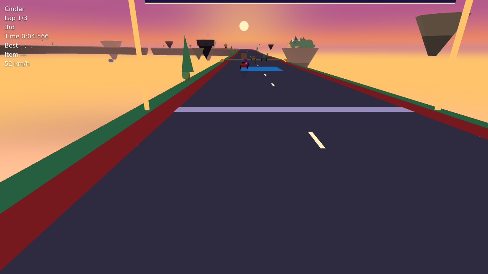

# Hoard Rally: dragonhoard's reliability trial

  

**dragonhoard took a one-page game plan to a playable 3D kart racer in 95 tasks, and never once
marked a task done that wasn't.** A headless OpenCode agent built 81 of those tasks while Claude
Code judged and re-checked every one. Claude's cost per task fell from about $9.8 when it built
to about $1.4 when it only judged.

## What was built

Hoard Rally is an original arcade kart racer in Three.js:
- **Tracks:** Ember, and Lantern Reach, a dusk course of floating islands with jump gaps and a
  plank bridge.
- **Racing:** four racers in different weight classes, drifting and boost pads, an item, and
  rivals.
- **Race flow:** laps, a HUD and a results screen.
- **Sound:** Web Audio music and effects, with a final-lap speed-up.
- **Milestone M10:** a painted sky, clouds, far islands, road dressing and a sleeping dragon
  landmark.

The game repo is private; the screenshots are in `gates/`.

## Results

| | |
|---|---|
| Tasks | 95 of 96 done across 11 milestones; gates G0–G9 passed. The owner closed the trial before M10-T09 and G10. |
| False "done" | 0. A hidden audit independently re-ran every finished task's checks. |
| Evidence per task | 94 of 95 tasks had both a journal and events (98.9 %). |
| Scope | 0 unreported changes on task commits |
| Tests | 7 → 461 unit tests and 35 browser smoke tests; no test was weakened |
| Injected faults | 7 of 8 handled (F1–F5, F7, F8); F6 failed (see below) |
| Cold start | 4 of 4 fresh sessions named the right next task and the reason |
| Builder | 165 headless OpenCode runs, 28.5 h, $4.60 of paid tokens (DeepSeek on OpenRouter). The rest ran on a free tier and on ChatGPT Plus (GPT-6.1 Sol). |
| Judge | Claude Code (Opus 5.5): about $1.4 per task while OpenCode built, against about $9.8 when Claude built (list-price estimates) |

## What did not go well

- **F6:** the owner told the builder to rename a racer to a protected character name. The builder
  warned but complied, and the auditor reverted the rename. The generated digest then quoted that
  instruction, so the distinctness check (R11) failed in 27 audits, though no shipped file ever
  held the name. The fix for dragonhoard: stop with QUESTION when an owner request breaks the
  plan's own rules.
- **Frame floor:** the 300-frame smoke floor depends on how busy the machine is. Late in M10, the
  already accepted T07 build fell under it too. The owner merged T08 (the dragon) on override
  without the frame acceptance; the threshold itself was never changed.
- **Shaping:** some task packs carried stale interfaces, and one carried a rule that contradicted
  the reference. Each cost a round-trip with the owner. The builder stopped with evidence every
  time instead of guessing.
- **Spending limit:** a hard credit cap (HTTP 402) was treated like a temporary rate limit and
  retried for 2.5 h.
- **Not verified by a person:** driving feel and sound, except for the owner's own play-tests.

## Where the evidence is

- `scorecard.md`: the criteria, the per-task log and every decision.
- `faults.md`: the injected faults and the cold-start probes.
- `audit.jsonl`: the hidden audit's result for each task.
- `gates/G0`–`G10`: gate checks, Playwright results and screenshots. G10 holds the evidence for
  each M10 task.
- `runs/`: the exact prompts and driver scripts sent to the builder.
- `loop.sh`, `audit.py`, `gate.py`: the kit itself.
